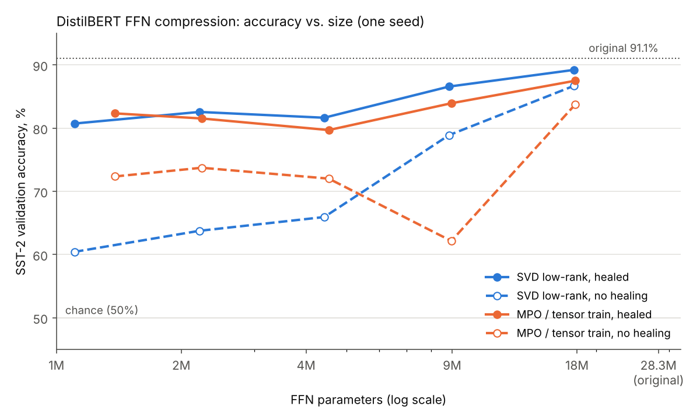

# tn-compress: SVD vs. tensor-network compression of DistilBERT

A small, reproducible experiment on quantum-inspired model compression. The 12
feed-forward (FFN) weight matrices of a DistilBERT sentiment classifier are
replaced with either a **low-rank SVD** or an **MPO / tensor train**, at matched
parameter budgets. Each compressed model is then **healed** with a short fine-tune.

The MPO + healing recipe follows the approach described in
[CompactifAI (Tomut et al., 2024)](https://arxiv.org/abs/2401.14109), scaled down
to a model that trains on a single consumer GPU.



## Key results

Original model: **91.06%** SST-2 validation accuracy, 28.3M FFN parameters
(of 67.0M total).

1. **Healing does most of the work.** At ~12.7× FFN compression, accuracy before
   healing is 63.8% (SVD) / 73.7% (MPO), and after one short healing epoch it is
   82.6% / 81.5%. The whole model goes from 67.0M to 40.9M parameters (−39%).
2. **Before healing, the better method depends on the budget.** At light
   compression (1.6×, 3.2×), SVD keeps more accuracy. At strong compression
   (≥ 6×), MPO keeps more: 72.0% vs. 65.9% at ~6×, and 73.7% vs. 63.8% at ~13×.
3. **Reconstruction error is a weak predictor of accuracy.** MPO has the higher
   Frobenius reconstruction error (`python diagnose.py`), yet it is the more
   accurate method at strong compression before healing.
4. **After healing, the methods are close.** At matched budgets, SVD is equal or
   0.8–2.7 points ahead, which is within single-seed noise on an 872-sentence
   validation set (one sentence = 0.11 points).

## Full results

FFN compression ratio = original FFN parameters / compressed FFN parameters.

| Method | Setting | FFN params | FFN ratio | Model params | Acc., no healing | Acc., healed |
|---|---|---:|---:|---:|---:|---:|
| original | – | 28,311,552 | 1.0× | 66,955,010 | 91.06 | – |
| SVD | rank 384 | 17,694,720 | 1.6× | 56,338,178 | 86.70 | 89.22 |
| MPO | χ 384 | 17,808,384 | 1.6× | 56,451,842 | 83.72 | 87.50 |
| SVD | rank 192 | 8,847,360 | 3.2× | 47,490,818 | 78.90 | 86.58 |
| MPO | χ 192 | 8,961,024 | 3.2× | 47,604,482 | 62.16 | 83.94 |
| SVD | rank 96 | 4,423,680 | 6.4× | 43,067,138 | 65.94 | 81.65 |
| MPO | χ 96 | 4,537,344 | 6.2× | 43,180,802 | 72.02 | 79.70 |
| SVD | rank 48 | 2,211,840 | 12.8× | 40,855,298 | 63.76 | 82.57 |
| MPO | χ 64 | 2,239,488 | 12.6× | 40,882,946 | 73.74 | 81.54 |
| SVD | rank 24 | 1,105,920 | 25.6× | 39,749,378 | 60.44 | 80.73 |
| MPO | χ 48 | 1,385,472 | 20.4× | 40,028,930 | 72.36 | 82.34 |

The last pair is not budget-matched: MPO χ = 48 has 25% more FFN parameters
than SVD rank 24.

## Method

| Method | Weight matrix W (out, in) becomes | Parameters |
|---|---|---|
| SVD low-rank | A (out, r) · B (r, in) | r · (out + in) |
| MPO / tensor train | 4 cores of shape (r<sub>k−1</sub>, o<sub>k</sub>, i<sub>k</sub>, r<sub>k</sub>), every r<sub>k</sub> ≤ χ | Σ<sub>k</sub> r<sub>k−1</sub> · o<sub>k</sub> · i<sub>k</sub> · r<sub>k</sub> |

- **Factorization:** 768 = 4·6·4·8 and 3072 = 4·8·8·12. The cores come from TT-SVD:
  sequential truncated SVDs, left to right.
- **Bond dimensions actually used:** the mode sizes cap the outer bonds at
  r<sub>1</sub> ≤ 16 and r<sub>3</sub> ≤ 96, so for χ ≥ 96 the bond dimension only
  changes the middle bond r<sub>2</sub>. For example, one 3072×768 matrix at χ = 96 has cores
  (1,4,4,16) · (16,8,6,96) · (96,8,4,96) · (96,12,8,1) = 378,112 parameters,
  6.2× fewer than 2,359,296.
- **Healing:** 1 epoch over 8,000 SST-2 training sentences, batch size 32 (250 steps),
  AdamW, learning rate 3e-5, bf16 autocast. All parameters are trainable,
  including the SVD factors and MPO cores.
- **Model and data:** `distilbert-base-uncased-finetuned-sst-2-english`, evaluated
  on the 872-sentence SST-2 validation set. Only the FFN layers are compressed.
  Attention and embeddings are untouched.
- **Hardware:** one RTX 5080 (16 GB).

## Run

```bash
python -m venv .venv
.venv\Scripts\activate            # Linux/macOS: source .venv/bin/activate
pip install torch --index-url https://download.pytorch.org/whl/cu128
pip install -r requirements.txt
pytest -q

python run_experiment.py                 # compression only (~2-5 min on a GPU)
python run_experiment.py --heal          # + healing; --seed N to change the seed
python plot_results.py                   # results.csv -> results.png
python diagnose.py                       # reconstruction error per setting
python layer_sensitivity.py              # accuracy drop when compressing one layer at a time
```

## Code

| File | What it does |
|---|---|
| `tn_compress/decompose.py` | SVD low-rank, TT-SVD into MPO cores, reconstruction, error |
| `tn_compress/layers.py` | `LowRankLinear` and `MPOLinear`: trainable drop-in replacements for `nn.Linear` |
| `tn_compress/model.py` | Loads DistilBERT and swaps all (or selected) FFN layers |
| `tn_compress/heal.py` | Short fine-tune after compression |
| `run_experiment.py` | Full sweep → `results.csv` |
| `layer_sensitivity.py` | Compresses one FFN matrix at a time → `layer_sensitivity.csv` |
| `tests/` | Exactness at full rank, error decreasing with rank / χ, core shapes, gradients |

## Limitations and open questions

- **One seed.** Differences of 2–3 points between methods are not significant.
  The next step is three seeds with mean ± std.
- **MPO χ = 192 before healing (62.2%) is below χ = 96 (72.0%)**, although χ = 192
  only enlarges the middle bond and has twice the parameters. `layer_sensitivity.py`
  tests whether one or two fragile layers cause this. The unit tests check that the
  decomposition is exact at full rank and that, on random matrices, error decreases with χ.
- **Size, not speed.** In evaluation the compressed weight is rebuilt as a dense
  matrix, so no inference speedup is claimed. That would need contraction-based
  forward passes or dedicated kernels.
- **Small model, easy task.** SST-2 is binary (chance = 50%), and DistilBERT is far
  from LLM scale. A natural next step is a small decoder LLM, with
  perplexity as the metric.

## License

MIT
